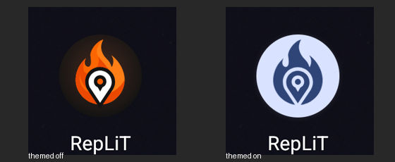
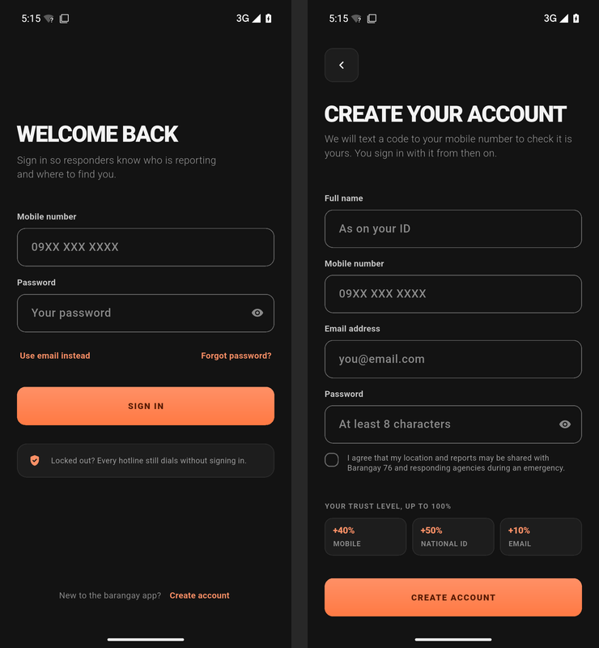

# Figma pass 4 in the app

What the REPLIT (MAIN) Figma file's passes 2–4 asked of the mobile app, what
this change built, and what stays in Figma until the app can honour it.

**Sources.** Figma file `yTInpc7mWlTug0PQzKiW0L` (REPLIT (MAIN)), read on
14–15 Oct 2026: 03 Design Foundations, 04 Component Library, 05 Citizen,
06 Coordinator, 07 Responder and 09 Developer Handoff, starting from the
"Start here · current guidance" indexes on 03 and 09. Behaviour comes from
PRD v12.0 and the code as it is; appearance from the newest pass board for
each topic. A separate `figma-main-pass4.md` was not on this machine, so the
file's own 00 Project Overview and 09 handoff boards were the pass 4 record.

**Scope.** UI only. No backend, API, permission or data change, and no new
screens: a Figma screen whose feature the app does not have stays in Figma
(see [Standby](#standby-backlog)).

Figma links below are `https://www.figma.com/design/yTInpc7mWlTug0PQzKiW0L/REPLIT---MAIN--?node-id=<id>`
with the node id's `:` written as `-`.

---

## What changed

| Area | What the app does now | Where |
|---|---|---|
| Icons | One filled family — Material Symbols Rounded, Fill 1, weight 400, grade 0, optical size 24 — for every icon in the app (108 glyphs). check, close, add and the chevrons stay 2 px strokes. Nothing is a tinted bitmap any more. | `lib/widgets/app_icons.dart`, `assets/fonts/app_symbols.ttf`, `tool/symbols/` |
| Tokens | Pass 4 semantic colours: text primary `#F3F3F3`, tertiary `#A1A1A1`, muted `#8A8A8A` as the floor; card edges on the PRD hairline `rgba(72,72,71,.35)`; the 3 : 1 control border `#686868` on fields, switch tracks, secondary buttons and progress tracks; warning `#FFB020`; info `#5B93F5`; police text violet-300 `#B192F9`; map/you `#FFA685`; marker surfaces (700 steps); glass, glass strong, scrim. Type floor 11 px; field value 16 px. | `lib/theme.dart` |
| Status | The Status badge (tinted pill, 11 px label, sentence case) and the Lifecycle chip: amber needs a decision or a record, blue verified, red under way, green out, grey off the feed. Staff screens read the PRD words ("En route", "Report pending"). | `Tag`, `LifecycleChip` in `lib/widgets/design.dart`; `lib/screens/responder/responder_status.dart` |
| Navigation | Filled glyphs in both states, the 56 × 32 selected pill with a 1.5 px coral edge, a bold label, the white ring on the disc's own screen; "Map, tab 1 of 5" for screen readers, with a tap action TalkBack can use. | `lib/widgets/app_nav_bar.dart` |
| Scroll fades | 40 px edge fades that follow the real scroll position, take no touches and are hidden from screen readers. On Hotlines, Guides, Profile, My duty, the coordinator queue, the citizen-report review and the Post-Incident Report. Never on a map. | `lib/widgets/scroll_fade.dart` |
| Map | Pass 3 markers (700-step surface, white glyph, white edge, ground plate, 48 px target, a spoken name, a pulse on a live Area); layer chips as a 36 px pill in a 44 px target with a check; glass for chips and the place card, glass strong for the sheet and controls, glass strong everywhere on the OpenStreetMap fallback, solid under high contrast; the place card grows with its text; the you dot; 48 px glass map controls with no shadow. | `lib/widgets/map_marker.dart`, `map_glass.dart`, `you_are_here.dart`, `incident_map.dart`; `lib/screens/map_screen.dart`, `live_update_screen.dart` |
| Forms | Persistent sentence-case labels (Type/Label) 8 px over 54 px fields; the Text button with a 44 px target; the Chip for the hotline filters. | `LabeledField`, `TextLink`, `FilterChips` in `design.dart`; `lib/screens/login_screen.dart` |
| Motion | See [Motion](#motion). | `lib/widgets/motion.dart` |
| Launcher icon | Pass 4 Treatment A. See [Android launcher icon](#android-launcher-icon). | `android/app/src/main/res/` |

## Motion

| What | Timing | Reduced motion |
|---|---|---|
| Press feedback on buttons and the nav disc | 100 ms, ease-out, scale to 0.97 under the finger | No scale; the pressed overlay still shows |
| State change (status badge tone, chip) | 200 ms, standard easing | 150 ms cross-fade |
| Nav pill, disc ring, scroll fades | 150 ms fade | Instant |
| Sheets and dialogs (all 24, via `showAppSheet` / `showAppDialog`) | 280 ms in, decelerate; 200 ms out, accelerate; scrim 64 % | Snap |
| Live dot, live Area marker | 1 600 ms pulse | Stopped; the word and colour stay |

Reduced motion is the phone's own setting (`MediaQuery.disableAnimations`,
Android's "Remove animations"); nothing else in the app loops.

## Android launcher icon

Treatment A — the orange flame and white location pin on the dark ground —
from the Figma masters on 04: Foreground `604:1700`, Background `604:1711`,
Monochrome `604:1713`.

- `drawable/ic_launcher_foreground.xml` and `drawable/ic_launcher_monochrome.xml`
  are vector drawables with the Figma path data copied unchanged. The SVG
  export also carries the section around the component (a `#1E1E1E` canvas
  fill and the section frame); those were left out, nothing else.
- `drawable-v26/ic_launcher_background.xml`: `#131313` with the radial coral
  glow (`#FF7943` at 22 % to clear, centre 54, 50, radius 40). Vector
  gradients need API 24, and only adaptive icons (API 26+) read it.
- `mipmap-anydpi-v26/ic_launcher.xml` and `ic_launcher_round.xml` point at
  the three layers. No padding or mask is added: the layers are already
  108 dp with the mark inside the 66 dp safe zone.
- Legacy `ic_launcher.png` and `ic_launcher_round.png` in every density are
  rendered from the same two layers — the centre 72 dp an adaptive launcher
  shows. The Composite Preview, Mask Previews and Play Store image were not
  used. The round PNGs are new; before, `roundIcon` had nothing to fall back
  to on API 25.
- Application ID, signing and every other platform setting are unchanged.

**Checked on:** a Pixel 7 emulator, Android 15 (API 35), Pixel launcher —
circle mask, themed icons off and on (screenshots below).
**Not checked:** a Samsung launcher (squircle) or any physical phone — none
was attached. The Play Store 512 image is a Play Console upload, not part of
the APK, and was not touched.

---

## Coverage matrix

Status: **READY** the screen and its behaviour exist — the design is applied ·
**PARTIAL** some of it exists — the supported part is applied, the rest is
listed · **STANDBY** the feature or integration does not exist — stays in
Figma · **BLOCKED** cannot be done right without an answer.

"Shared" in the action column means the screen picks up the tokens, icons,
status badge, buttons, fields, sheets and motion from the shared widgets
without its own code changing.

### Citizen (05)

| Screen | Figma | App source · data | Status | Action in this change | Validation |
|---|---|---|---|---|---|
| 01 Splash | `1:2` | `splash_screen.dart` | READY | Shared | `splash_test` |
| 02 Sign in | `2:1139` | `login_screen.dart` · `POST /auth/login`, password reset | READY | Sentence-case labels and text links, 3 : 1 fields, filled icons. The "New affiliate? Register here" link is standby (no URL) | `phone_signup_test`; on device, compared with the frame |
| 03 Sign up | `15:395` | `register_screen.dart`, `phone_verify_screen.dart` · signup, OTP | READY | Shared (labels, fields) | `phone_signup_test`, `phone_verify_test` |
| 04 Map | `15:1039` | `map_screen.dart` · `GET /areas`, `/map/*` layers | READY | Markers, layer chips, glass rules, place card, you dot, map controls, nav | `map_screen_test` (1.0×, 1.5×), `map_live_test`, `map_marker_test` |
| 05 Area detail | `84:272` | `area_detail_screen.dart` · `GET /areas/{id}` | PARTIAL | Shared; selected Incident marker on the map. Rail keeps the resident words and five steps (see conflicts) | `area_detail_test` |
| 10 Corroborate | `179:395` | `neighbour_alert_screen.dart` · `POST` alert response | READY | Shared | `notifications_test` |
| 06 SOS | `120:577` | `home_screen.dart` · 3 s hold | READY | Disc ring on its own screen; shared | `active_report_test` |
| 07 Report | `134:983` | `sos_report_screen.dart`, `camera_capture_screen.dart` · `POST /reports/submit` | READY | Shared | `one_report_test`, `citizen_flow_test` |
| 08 Submitting | `155:506` | `sos_report_screen.dart` | READY | Shared | `citizen_flow_test` |
| 09 Live tracking | `155:1132` | `report_status_screen.dart`, `live_update_screen.dart` · `GET /areas/{id}/tracking`, socket | PARTIAL | Incident marker with live pulse, shelter markers. Responding trucks stay (see conflicts) | `track_it_live_test`, `report_status_test` |
| 11 Hotlines | `183:1271` | `call_screen.dart` · static directory | READY | Real scroll fade, the Chip | `widget_test` |
| 12 Guides | `183:2247` | `guide_screen.dart` | READY | Real scroll fade | `widget_test` |
| 13 Guide details | `183:2670` | `guide_detail_screen.dart` | READY | Shared | `widget_test` |
| 14 Profile | `189:3422` | `profile_screen.dart` · `GET /auth/me`, verification status | READY | Scroll fade, status badge. The light-ground switch stays (an existing feature; Figma has no light mode, Q9) | `profile_test` (1.0×, 1.5×) |
| 15 Verification | `192:4076` | `verification_screen.dart` | READY | Shared | `profile_test` |
| 16 National ID · start | `460:1002` | `national_id_screen.dart` (manual path only) | PARTIAL | Shared; no Didit choice is shown | — |
| 17 Didit · hand-off | `460:1080` | — | STANDBY | — | — |
| 18 National ID · verified | `460:1121` | — | STANDBY | — | — |
| 19 Manual check | `460:4574` | `national_id_screen.dart` · `POST /verification/national-id/manual` | READY | Shared | — |
| 20 ID photo | `460:4632` | `national_id_screen.dart` (camera only) | READY | Shared | — |
| 20B Selfie | `464:1209` | `national_id_screen.dart` (camera only) | READY | Shared | — |
| 21 In review | `460:4655` | `verification_screen.dart` | READY | Shared | — |

### Coordinator (06)

The app's coordinator works in the shared staff console (`StaffScaffold`,
v1.12.3): a top bar and one menu. Figma draws a bottom nav (Queue · Map ·
LIVE · Codes · Profile). That difference is deferred (see conflicts), so the
screens below get the visual system inside the console.

| Screen | Figma | App source · data | Status | Action in this change | Validation |
|---|---|---|---|---|---|
| C01 Queue · to decide | `487:1744` | `subadmin_home_screen.dart`, `subadmin_dashboard_screen.dart` · `GET /incidents` | PARTIAL | Lifecycle chips, scroll fade. No counted segment control | `subadmin_test` |
| C02 Queue · active | `487:1950` | as C01 | PARTIAL | as C01 | `subadmin_test` |
| C03 Queue · to file | `487:2112` | `pending_reports_screen.dart` · owed reports | PARTIAL | Shared | `subadmin_test` |
| C04 Area detail · decision | `488:2140` | `subadmin_incident_report_screen.dart` · verify, self-dispatch, reject, fire out | PARTIAL | Scroll fade, chips. No single "Accept" act: the client has verify and self-dispatch as two calls | `subadmin_test` |
| C05 Accept · unit | `489:2313` | — | STANDBY | — | — |
| C06 Reject · confirm | `489:2391` | report and command screens · `rejectIncident` | READY | Dialog timing and scrim | `subadmin_test` |
| C07 Overlap · merge | `488:2305` | — | STANDBY | — | — |
| C08 Map · monitoring | `490:2589` | `subadmin_dashboard_screen.dart` live map | PARTIAL | Shared map glass and controls | `subadmin_test` |
| C09 Route choice | `490:2934` | — | STANDBY | — | — |
| C10 Navigation | `490:3004` | `directions_screen.dart` (one route, no voice) | PARTIAL | Shared | `directions_live_test` |
| C11 Live · units | `491:2901` | `subadmin_incident_command_screen.dart` | PARTIAL | Shared | `subadmin_test` |
| C11b Fire codes | `491:3052` | inside the command screen · `getFireCodes`, `pressFireCode` | PARTIAL | Shared (not a tab) | `subadmin_test` |
| C12 Mark fire out · confirm | `491:3172` | `resolveIncident` with confirmation | READY | Dialog timing and scrim | `subadmin_test` |
| C13 Post-incident report | `492:3234` | `post_incident_report_screen.dart` · `filePostIncidentReport` | READY | Scroll fade above the action | `subadmin_test` |
| C14 Report filed · narrative | `492:3381` | filing exists; AI summaries in `ai_summaries_screen.dart` | PARTIAL | Shared. No fire-out narrative state | `ai_summaries_screen_test` |
| C15 Profile | `492:6080` | — | STANDBY | — | — |
| C15b What you can do | `492:6208` | — | STANDBY | — | — |
| C16 My decisions | `492:6340` | — | STANDBY | — | — |

C15's prototype defect (the bottom fade over the lower 19 px of "My
decisions") does not exist in the app: there is no C15 screen, and every
fade the app draws is `IgnorePointer`.

### Responder (07)

Since v1.12.17 the responder has the Responder app: `ResponderShell` with
the Duty · Map · RUN · Alerts · Profile bar — the same `NavBarShell` and disc
as the resident's SOS and the coordinator's LIVE. Figma's fourth tab, Runs
(R12), needs a list of a responder's past runs that no endpoint gives; it
stays on standby, and Alerts (the inbox the old console reached from the
bell) holds the slot. The old dashboard, "My duty", the responder incident
list and the old report view are gone; each one's information and actions
moved to the screens below.

| Screen | Figma | App source · data | Status | Notes | Validation |
|---|---|---|---|---|---|
| R01 Duty · needs a unit | `390:3` | `duty_tab.dart` · `GET /incidents`, `/incidents/stats` | READY | Area cards say "Area 1.2" where Figma names an incident type: the API has no type. The old dashboard's counters stay, under "Pasay now" | `responder_app_test` |
| R02 Duty · nothing waiting | `390:185` | `duty_tab.dart` | PARTIAL | "Last run" needs a responder's run history (no endpoint); the run of this session shows as "Your run" | `responder_app_test` |
| R03 Area brief | `390:280` | `responder_incident_screen.dart` · `GET /incidents/{id}`, `/reports` | READY | Title is the street (no incident type). Reports opens every report; "Verify, without going" keeps the old Verify on a Reported Area | `responder_app_test` |
| R04 I am going · confirm | `390:393` | `verifyIncident` (if Reported), `selfDispatch` | READY | Then straight to the route choice | `responder_app_test` |
| R05 Route choice | `391:376` | `directions_screen.dart` (C09, shared) | READY | Fastest and shortest | `directions_live_test` |
| R05b Routes failed | `391:453` | `directions_screen.dart` | PARTIAL | Shared error state; not re-checked against R05b | `directions_live_test` |
| R06 Navigation · en route | `391:513` | `directions_screen.dart` (C10, shared) | READY | Maneuver banner and voice; arriving ends navigation and marks arrived | `directions_live_test` |
| R07 Navigation · GPS lost | `391:583` | `directions_screen.dart` | PARTIAL | Not re-checked in this change | — |
| R08 Mark arrived · confirm | `391:648` | `markArrived` | READY | Sheet | `responder_app_test` |
| R09 On scene | `392:592` | `responder_incident_screen.dart` (RUN) | READY | What happens next from real times. The codes (Need water, Need assistance, Escalate to BFP, Fire is out) stay | `responder_app_test` |
| R10 Stood down | `392:718` | `responder_incident_screen.dart` (RUN) | READY | "Capt. R. Alonzo" is "the Captain": the API does not name the captain | `responder_app_test` |
| R11 Field map | `392:838` | `field_map_tab.dart` | READY | Shared legend (`MapLayerChip`, `MapAreas`); "Around you" lists hydrants, shelters, water and cisterns within 500 m of the phone | `responder_app_test` |
| R12 Runs | `392:1010` | — | STANDBY | No endpoint lists a responder's past runs | — |
| R13 Profile | `394:996` | `responder_profile_tab.dart` | PARTIAL | "Affiliate registration" needs its URL (standby) | `responder_app_test` |
| R14 What you can do | `394:1146` | `CapabilitiesScreen` (shared with C15b) | READY | Mirrors the server's rules | `responder_app_test` |

## Standby backlog

Nothing below has a route, a placeholder or a fake answer in the app.

| Figma | Missing | Activate when |
|---|---|---|
| 05 · 17, 18 Didit hand-off and verified | Didit web view and its success callback (PRD §17.3: no credits) | Didit is funded and the backend accepts its callback; manual review (19–21) stays the fallback |
| 05 · 02 "New affiliate? Register here" | An affiliate registration URL | The URL exists and is set at build time |
| 06 · C05 Accept with unit picker | One-act accept (`POST /incidents/{id}/accept {self_dispatch, unit_id}`) in the client; Q3 (unit per run or per account) | Q3 is answered and the client calls the endpoint |
| 06 · C07 Merge or keep separate | A merge endpoint in the client | The backend exposes merge to coordinators |
| 06 · C09, 07 · R05, R05b Route choice | Up to three truck-passable routes and `POST /routes/choose` (work on branch `feat/turn-by-turn`, not merged) | That work lands |
| 06 · C10, 07 · R06 maneuver banner and voice | Turn-by-turn instructions and text-to-speech | As above |
| 07 · R12 Runs, and R02's "Last run" | An endpoint for a responder's own past runs | The backend lists them; Runs then takes the fourth tab back from Alerts |
| 07 · R13 "Affiliate registration" | An affiliate registration URL | The URL exists and is set at build time |
| Coordinator counted queue segments (C01–C03) and staff bottom navigation | A product decision (conflict 1) | Decided |

## Conflicts and intentional differences

1. **Staff navigation.** Resolved. Coordinators (v1.12.10) and responders
   (v1.12.17) have their Figma bars on the one `NavBarShell`; the old
   console's problems (a bar that sent responders to the citizen profile)
   do not recur because each role's tabs are its own. The disc in the middle
   is one object for SOS, LIVE and RUN, glow included: the PRD §4.7.1 rule
   that only SOS glows gave way to the direction that all three match.
2. **Responding trucks on a citizen's live tracking.** PRD §4.4 and the
   Figma audit (F1) leave responding units off citizen screens. The app's
   Track It Live shows them to the reporter, which the backend allows
   (`can_track`). The behaviour is unchanged here; whether reporters should
   see trucks is for the PRD owner.
3. **Resident status words.** Figma's citizen frames use the PRD words and
   a six-step rail ending at Closed. The app tells residents "On the way" and
   "On scene" on a five-step rail, by an earlier deliberate choice. Kept for
   residents; staff now read the PRD words.
4. **Token files in step (PRD §8.1).** `lib/theme.dart` now carries the pass 4
   values; `admin-web` and `observer-web` still have the old ones. The web
   consoles were out of this pass, so they follow separately.
5. **Icons (PRD §8.3).** The PRD says 24 px line icons; the design uses the
   filled family by the user's direction (Figma 02, conflict 13). The PRD
   owner should update §8.3.
6. **Map markers.** `GET /areas` has no agencies, so every Area uses the
   Incident kind rather than the agency kinds; a marker no longer changes
   colour with status. The status is a word in the sheet and on the Area, and
   a live Area pulses.
7. **Light ground.** Figma has no light mode (Q9). The app's existing light
   ground stays, with derived light values for the new tokens.
8. **Hotline filters** keep one sideways-scrolling row; the Chip doc says
   list chip groups wrap.

## Checks

| Check | Result |
|---|---|
| `flutter analyze` | No issues |
| `flutter test` | 356 passed (341 before this change, plus new tests; the 4 bitmap nav-glyph tests were removed with the bitmaps) |
| New focused tests | `nav_bar_test` (6): selected pill, glyphs, semantics, disc ring, reduced motion, 1.5× at 320 px · `scroll_fade_test` (7): every scroll state, last row clears the fade, taps pass through, hidden from screen readers, reduced motion · `map_marker_test` (5): glyph and surface, selected size, 48 px target and name, pulse and reduced motion, contrast ≥ 3 : 1 for every kind |
| Tests changed with the design | Uppercase tag text to sentence case; old token values to pass 4; status tone test to the lifecycle tones; the coach-mark test finds the Incident marker |
| `flutter build apk --debug` | Built and installed |
| Runtime | Pixel 7 emulator, Android 15: launcher icon with themed icons off and on; Sign in (compared with Figma 02) and Create account on the final build |

## Screenshots

| Launcher icon, themed off and on | Sign in and Create account on the emulator | Icon layers (full, legacy, round, themed) |
|---|---|---|
|  |  |  |

## Not done, and device limits

- Signed-in screens were not captured on a device: that needs an account on
  a backend, and making one on the live system was not this change's call.
  They are covered by the widget tests at 402 × 874, at 1.0× and 1.5×.
- No physical phone and no Samsung launcher were available.
- Not measured: blur cost on a mid-range Android (the map keeps one
  `BackdropGroup` and gives its controls glass strong without a blur, to stay
  at three blurred surfaces), TalkBack reading order, and reduced
  transparency on iOS (Android's high-contrast setting is used).
- Not built: skeleton rows and loading-to-content cross-fades, the Toast
  restyle, the coordinator's counted segments, and per-screen layout changes
  beyond the shared components.
